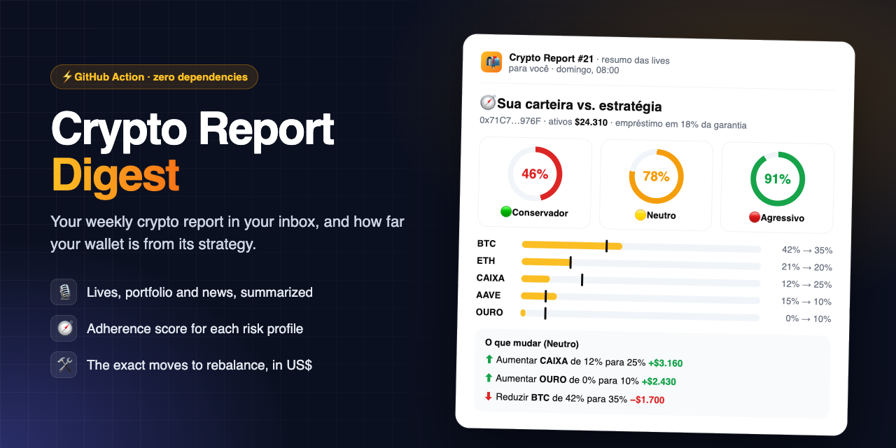
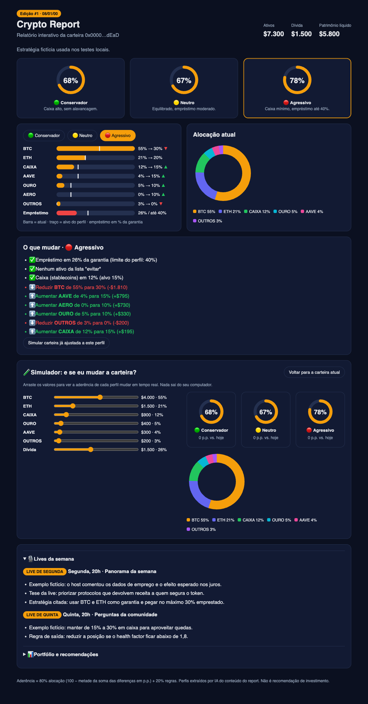
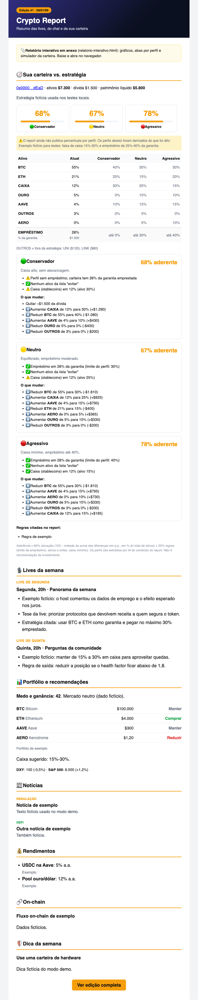
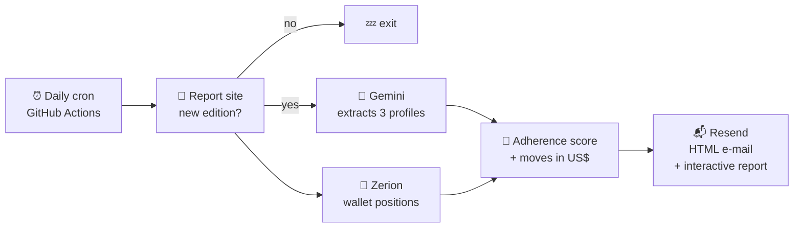

<p align="center">
  
</p>

<h1 align="center">Crypto Report Digest</h1>

<p align="center">
  <b>Your crypto report in your inbox, plus how far your wallet is from its strategy.</b><br>
  A tiny GitHub Action that e-mails each new edition of a crypto report (live summaries, portfolio, news, yields) and scores a wallet against the conservative, neutral and aggressive profiles the report talks about.
</p>

<p align="center">
  <a href="https://github.com/vinimcorrea/crypto-report-digest/actions/workflows/ci.yml"></a>
  
  
  
  <a href="LICENSE"></a>
  <a href="https://github.com/vinimcorrea/crypto-report-digest/stargazers"></a>
</p>

<p align="center">
  
</p>

---

## Why?

Your crypto community publishes a weekly report with the summaries of its lives, a reference portfolio and a few rules ("keep 15–30% in cash", "borrow at most 30% against your collateral"). You keep forgetting to read it, and when you do, you still have to open your wallet and do the math yourself.

**Crypto Report Digest** sends the new edition to your inbox and answers the question that matters: *how close is my wallet to what they recommend, and what should I change?*

> ⚠️ **Not financial advice.** The profiles are extracted by an LLM from the report content, and the adherence score is a simple formula.

## ✨ Features

- 📬 **Only new editions**: runs daily on GitHub Actions and only sends when there is a new edition.
- 🎙️ **The whole edition**: live summaries, reference portfolio with buy/hold/sell, fear & greed, macro, news, yields, on-chain and the tip of the week.
- 🧭 **Wallet vs. strategy**: an adherence score (0–100%) for the **conservative**, **neutral** and **aggressive** profiles, with a table of current vs. target allocation.
- 🛠️ **What to change**: concrete moves in US$ (e.g. *reduce BTC from 69% to 40%, -$1,680*), plus checks for the borrowing limit, minimum cash and assets to avoid.
- 📊 **Interactive report attached**: a self-contained `relatorio-interativo.html` with score rings, a tab per profile, current-vs-target bars, an allocation donut and a **what-if simulator** (drag your positions and debt, watch every profile's score update live). No CDN, no tracking; it works offline.
- 🏦 **DeFi aware**: reads Aave deposits and loans, LPs and staking on every chain through the [Zerion API](https://developers.zerion.io). Allocation is a share of your total assets (never negative), debt is checked against each profile's borrowing limit, and wrapped assets are grouped (WBTC/cbBTC → BTC, WETH/stETH → ETH, stablecoins → cash, XAUT/PAXG → gold).
- 🤖 **LLM strategy extraction**: [Gemini](https://aistudio.google.com) reads the last 4 editions and turns them into structured profiles. When the report doesn't publish explicit percentages, they are derived from the ranges it mentions and the e-mail says so.
- 🔐 **Private by design**: everything that identifies you lives in Actions **secrets**, logs never contain balances, and no artifacts are uploaded.
- 🪶 **Zero dependencies**: plain Node 22, no build step.

<details>
<summary>📊 Interactive report (attachment)</summary>
<p align="center"></p>
</details>

<details>
<summary>📸 Full e-mail</summary>
<p align="center"></p>
</details>

## 🚀 Setup

1. **Create your own private copy.** Click **Use this template** (or clone it) and make the new repository **private**. In public repositories, Actions logs and the state commits are public.
2. **Get the API keys** (all have free tiers):
   - [Resend](https://resend.com/api-keys) to send the e-mail
   - [Zerion](https://dashboard.zerion.io) to read the wallet
   - [Gemini](https://aistudio.google.com/apikey) to extract the strategy
3. **Add the secrets** in *Settings → Secrets and variables → Actions → Secrets*:

   | Secret | Value |
   |---|---|
   | `REPORT_BASE_URL` | URL of the report site |
   | `REPORT_USER` / `REPORT_PASS` | HTTP Basic Auth login of the site |
   | `RESEND_API_KEY` | Resend API key |
   | `EMAIL_TO` | recipient(s), comma separated |
   | `EMAIL_FROM` | optional; without a verified domain Resend only delivers to the account owner |
   | `ZERION_API_KEY` | Zerion API key |
   | `GEMINI_API_KEY` | Gemini API key |
   | `WALLET_ADDRESS` | optional; the wallet to analyze (the section is skipped without it) |

   Optional **variables**: `REPORT_NAME` (title of the e-mail, default *Crypto Report*) and `LLM_MODEL` (default `gemini-flash-latest`, with automatic fallback).
4. **Test it**: *Actions → Newsletter → Run workflow* with **preview** checked. You get a `[PRÉVIA]` e-mail and nothing is recorded.

## 🧠 How it works



| Step | What happens |
|---|---|
| **Fetch** | Downloads the report site with HTTP Basic Auth and extracts the editions embedded in its JS bundle (an array of objects with `slug`, `lives`, `market`, `news`, `yields`, `onchain`, `tips`). For another site, adapt `src/extract.mjs`. |
| **Strategy** | Gemini reads the last 4 editions and returns the profiles: allocation %, max borrowing, rules and assets to avoid. |
| **Wallet** | Zerion returns balances and DeFi positions. Assets are grouped into buckets as a % of total assets; loans are kept apart as % of collateral. |
| **Score** | 80% allocation (100 − half the sum of the differences in p.p.) + 20% rules (borrowing limit, assets to avoid, minimum cash). |
| **Send** | The e-mail (email-safe HTML) and the interactive report (attached `.html` with inline JS) go out through Resend and `state/last-sent.txt` is committed so the same edition is never sent twice. |

The e-mail content is in Portuguese (pt-BR), like the report it summarizes.

## 💻 Run locally

Requires Node 22+. No `npm install` needed.

```bash
git clone https://github.com/vinimcorrea/crypto-report-digest.git
cd crypto-report-digest
npm run demo               # offline demo with fictional data -> preview.html + relatorio-interativo.html
cp .env.example .env       # fill in your values
npm run preview            # real data -> preview.html (nothing is sent)
npm run preview:fixtures   # real report, fictional wallet/strategy (no Zerion/Gemini calls)
npm run send               # send for real
```

## 🔐 Privacy

- Run your instance in a **private** repository.
- Personal data (site, e-mail, wallet) only goes in **secrets**, never in variables: GitHub masks secrets in logs but not variables.
- Logs only contain error messages, never positions or balances, and the workflow uploads no artifacts.
- The interactive report is a single attached file with no external requests, so your wallet data is never sent to a third party when you open it.
- Everything in `test/` is fictional.

## 🗺️ Roadmap

- [ ] Summaries of the community chat
- [ ] Multiple wallets
- [ ] English e-mail template
- [ ] Pluggable extractors for other report formats (RSS, Notion, Substack)
- [ ] Other LLM providers

Have an idea? [Open an issue](https://github.com/vinimcorrea/crypto-report-digest/issues/new/choose).

## 🤝 Contributing

PRs are welcome! See [CONTRIBUTING.md](CONTRIBUTING.md).

## 📄 License

[MIT](LICENSE) © Vinicius Correa

---

<p align="center">If this saves you from reading the whole report every week, please <b>⭐ star the repo</b>. It helps others find it.</p>
